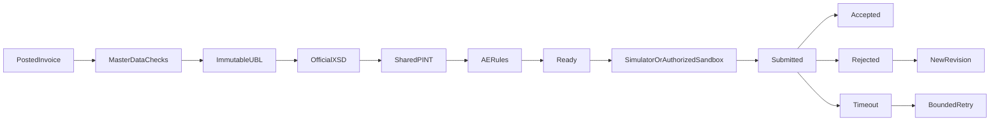

# E-invoicing source scope

UAE legal/endpoint fields, explicit S/Z/E VAT categories, native invoice/credit-note
mapping to UBL 2.1, line/document discounts, AED tax amounts for foreign-currency
invoices, rounding checks, immutable XML snapshots and hashes, schema/Schematron
validation hooks, transmission history, bounded retries, revisions of rejected
documents, and normalized provider states are authored.

Modes are simulator and an explicitly authorized generic sandbox contract. The
sandbox adapter contract is POST /submissions (XML, idempotency header), returning
JSON {id,status}, and GET /submissions/{id}; exact accepted states are SUBMITTED,
ACCEPTED and REJECTED. This is an adapter boundary, not invented endpoints for a
named ASP. Production mode is not enabled. Simulator ACCEPTED is stored separately
as SIMULATED_ACCEPTED and never represented as network accreditation.

Default fixture is demo-check-only and has transaction flags requiring manual
configuration from the current specification. It is not a valid certified invoice
fixture. See SCHEMA_SETUP.md. Strict validation never silently skips missing XSD,
shared rules, AE rules or SaxonC. Only strict-validated snapshots may reach a
sandbox. No certification, accreditation, legal compliance or live provider success
is claimed. Supply appropriate payment means, legal-ID types, transaction flags,
and all scenario-specific mandatory terms before expecting official rules to pass.
The scoped mapper supports one percentage VAT tax per line and positive sale/
credit quantities; tax grouping, rounding and extended scenarios remain unverified.
No schemas were executed, XML rendered, accounting records created or calls made.

